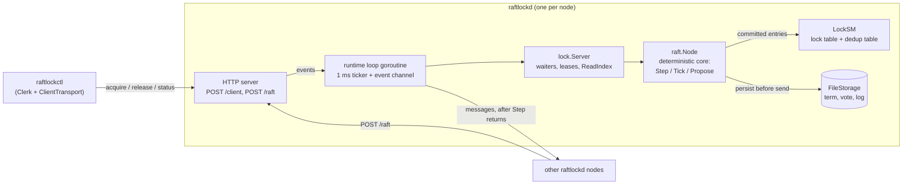

# RaftLock

A distributed lock service built on the Raft consensus algorithm, written in Go with the standard library (plus [Porcupine](https://github.com/anishathalye/porcupine) in tests).

Clients acquire and release named locks. Every lock operation is an entry in a replicated Raft log, so the lock table stays consistent across a three-node cluster and survives the loss of any one node. Each grant comes with a **fencing token**, the log index of the acquire entry, which only ever increases, so a resource can reject writes from a client whose lock has already been taken over.

The Raft core follows Figure 2 of Ongaro and Ousterhout, ["In Search of an Understandable Consensus Algorithm"](https://raft.github.io/raft.pdf) (extended version).

## Architecture



| Package | Role |
|---|---|
| `internal/raft` | The Raft node: elections, log replication, commit, apply. No goroutines, clocks or network. |
| `internal/storage` | `FileStorage`: CRC-checked state, written atomically and fsynced. |
| `internal/lock` | Lock state machine, lock server, leases, ReadIndex, and the retrying `Clerk`. |
| `internal/rpc` | Real runtime: one goroutine per node, HTTP/JSON between nodes and from clients. |
| `internal/netsim`, `internal/sim` | Seeded fake network, cluster harness, chaos monkey, linearizability model. |
| `internal/check` | The Figure 3 safety properties as executable checkers. |
| `cmd/raftlockd`, `cmd/raftlockctl`, `cmd/raftsim` | Node binary, CLI client, and a printed trace of a simulated cluster. |

Why it is built this way: [docs/decisions.md](docs/decisions.md).

## How to run

Start three nodes, one per terminal:

```
go run ./cmd/raftlockd --id n1 --listen :7001 --peers n2=:7002,n3=:7003 --data-dir /tmp/rl/n1
go run ./cmd/raftlockd --id n2 --listen :7002 --peers n1=:7001,n3=:7003 --data-dir /tmp/rl/n2
go run ./cmd/raftlockd --id n3 --listen :7003 --peers n1=:7001,n2=:7002 --data-dir /tmp/rl/n3
```

Within about a second one node logs `became leader`. Then use the CLI:

```
go run ./cmd/raftlockctl --servers :7001,:7002,:7003 --client c1 acquire jobs --ttl 5000
go run ./cmd/raftlockctl --servers :7001,:7002,:7003 --client c2 acquire jobs --ttl 5000
go run ./cmd/raftlockctl --servers :7001,:7002,:7003 --client c2 status jobs
go run ./cmd/raftlockctl --servers :7001,:7002,:7003 --client c1 release jobs --token 3
```

- `acquire` prints `acquired jobs token=N`. A second client is refused with exit code 1, naming the holder.
- `--ttl` is in milliseconds. When it runs out the leader replicates an `Expire` entry and the lock is freed.
- `release` needs the token from `acquire` and must come from the same `--client`.
- Kill the leader's process and run `status` again: a new leader is elected and still knows who holds the lock.

To watch elections without a network, print the trace of a simulated cluster:

```
go run ./cmd/raftsim -nodes 3 -seed 1 -ticks 600 -kill-leader-at 300
```

## How it is tested

```
make test
make vet
```

`make test` runs `go test ./... -race -count=1`.

- **Deterministic core.** `internal/raft` takes time only through `Tick()` and messages only through `Step()`, so unit tests drive it step by step, and every simulated run replays exactly from its seed.
- **Fake network.** `internal/netsim` drops, delays, duplicates, reorders and partitions messages. The harness crashes and restarts nodes from their stored state.
- **Safety checkers after every step.** Election Safety, Leader Append-Only, Log Matching, Leader Completeness and State Machine Safety (Figure 3) run on the whole cluster after each harness step. Each checker is itself tested with histories that must fail it.
- **Figure 8.** A test reproduces the paper's Figure 8 scenario on five nodes, so the current-term commit rule is exercised directly.
- **Chaos.** A seeded chaos monkey crashes, restarts, partitions and changes drop rates while clients use the locks. Run more seeds with `CHAOS_SEEDS=100`, or replay one failure with `CHAOS_SEED=n`; a failure prints its replay command.
- **Linearizability.** Recorded client histories are checked against a sequential lock model with Porcupine.
- **Lock semantics** (mutual exclusion, expiry, fencing, deduplication) are tested separately from consensus.
- **Real runtime.** `internal/rpc` and `cmd/raftlockctl` tests start three servers on localhost ports and talk HTTP with real 1 ms ticks, including failover.

## Deliberately out of scope

- **Membership changes.** The cluster is a fixed three nodes.
- **Snapshots and log compaction** (paper section 7). The log grows without bound; each save rewrites the whole state.
- **PreVote and CheckQuorum.** An isolated node that rejoins can force a needless election.
- **Lease-based reads.** Reads go through the log, or through ReadIndex, never through a leader's clock.
- **A wait queue.** A refused client retries; locks are not handed over in order.
- **Authentication and TLS.** Any client that can reach a node can act as any client id.
- **Formal verification.** The Figure 3 checkers are the invariants; a TLA+ model is future work.
